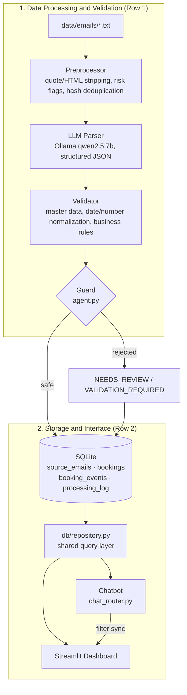

# UGR Booking AI

AI-powered email booking parsing, validation, and query pipeline.

> **Core Principle:** *The LLM reads and proposes, Python decides.* The model cannot write directly to the database; every change passes through validation rules and a "guard" layer.

## Architecture



| Layer | File | Responsibility |
|---|---|---|
| Preprocessing | `pipeline/preprocessor.py` | Header parsing, chronological ordering, quote/HTML stripping, injection patterns, attachment references, hash deduplication |
| LLM | `pipeline/llm_parser.py` | Structured extraction with Ollama (`FakeLLMParser` for tests) |
| Validation | `pipeline/validator.py`, `normalize.py`, `master_data.py` | Customer/port resolution, date/number normalization, blocking and warning flags, status determination |
| Guard + Tools | `pipeline/agent.py`, `tools/booking_ops.py` | `create/update/cancel_booking`; model proposals are not written without passing the guard, every decision is logged in `processing_log` |
| Storage | `models/orm.py`, `db/connection.py` | 4 tables, each booking is linked to its source via `source_email_id` |
| Query Layer | `db/repository.py` | Dashboard and chatbot call the **same** functions, ensuring consistent numbers |
| Interface | `ui/app.py`, `ui/chat_router.py`, `app.py` | KPIs, filters, data table, Review Queue, charts, chatbot |

## Installation

```bash
# Set up virtual environment and sync dependencies (default: SQLite)
uv sync --extra dev

# (Optional) If you want to run with PostgreSQL in the future:
# uv sync --extra dev --extra postgres

# Pull the model (Ollama server must be running)
ollama pull qwen2.5:7b
```

## Configuration

You can configure the `.env` file based on `.env.example`:

```env
DATABASE_URL=sqlite:///./ugr_booking.db
OLLAMA_HOST=http://localhost:11434
OLLAMA_MODEL=qwen2.5:7b
DATA_PATH=./data
LOG_LEVEL=INFO
```

### Data Package

Since the case dataset is confidential, it is **not included** in the repository (`data/` is git-ignored). The following structure is expected under `DATA_PATH`:

```text
data/
├── emails/            # EMAIL-001.txt ... EMAIL-034.txt
├── manifest.json      # email sequence / received_at
└── master_data/       # customers.json, ports.json, booking_schema.json
```

For presentation/testing purposes, the expected results are in `plan/expected_outcomes.json` (golden set); this file is also git-ignored.

## Running

```bash
# 1) Process emails (real Ollama)
uv run python scripts/run_pipeline.py

#    Reuse saved LLM responses (Ollama not required)
uv run python scripts/run_pipeline.py --reuse-llm-cache
#    Save responses to cache on the first real run
uv run python scripts/run_pipeline.py --reuse-llm-cache --write-cache

# 2) Compare results with the golden set
uv run python scripts/eval_real_llm.py --output docs/eval_results.md

# 3) Dashboard + chatbot
uv run streamlit run app.py
```

If Ollama is unreachable or routing returns an invalid result, the chatbot falls back to a regex-based fallback router; the 4 sample questions of the case study work under this fallback as well.

## Testing

```bash
uv run pytest
```

- Unit tests: normalization, preprocessing, validation, guard/tools, repository, chat router.
- `tests/test_pipeline_e2e.py`: Processes 34 emails into a temporary DB and verifies that **no false READY status occurs**. Skipped if confidential data or LLM cache is missing.
  Full match checks against the golden set require a fresh cache: `E2E_STRICT_GOLDEN=1 uv run pytest tests/test_pipeline_e2e.py`.

## Assumptions

- Customer and port matching is performed strictly against master data using exact (case/accent-folded) matching; there is no fuzzy matching. The sender domain alone does not resolve the customer; it is only a hint.
- Uncertain values are never guessed; fields are left empty and marked as `VALIDATION_REQUIRED`.
- Total booking count counts only the `bookings` table (orphans, status inquiries, and non-booking emails are excluded).
- Chatbot figures are template-generated; the LLM does not generate numbers directly. For information not present in the records, a fixed response is returned: *"Bu bilgi mevcut kayıtlarda bulunmuyor."* (This information is not found in existing records).

## Known Limitations and Gaps

The table below summarizes the system's current limitations, root causes, and potential next-phase solutions:

| Limitation / Gap | Root Cause | Potential Solution | Example Scenario |
|---|---|---|---|
| **Failing to Capture Correction Emails as Updates** (014, 015) | The 7B model missed conversational context, treating the correction as a new booking request. | Few-shot prompting or using a more capable model (GPT-4o/Claude). | *"Correction: please update date to 15.10.2026"* |
| **Lack of Fuzzy Matching for Orphan Updates** (003, 007) | The system only looks for exact reference matches; when none is found, it marks the record directly as `ORPHAN`. | Introduce a Fuzzy Matcher scoring candidate records by customer and date window to offer suggestions to the operator. | *"Please change the loading date for yesterday's booking"* |
| **Inability to Read Attachment Contents** (029) | The system lacks an OCR or PDF/Excel parsing pipeline. | Prepend `pypdf`, OCR, or a multimodal LLM to the pipeline to extract attachment text. | *"Please find attached our booking request and VIN list"* |
| **Legitimate Customers from Unknown Domains** | The sender/customer mismatch rule (`SENDER_CUSTOMER_MISMATCH`) immediately flags the request as suspicious. | Add personal email addresses to an allowed contact list or send a verification code to the corporate domain. | An authorized ABC Shipping contact submitting a request from a personal or alternative address. |

> **Security Note:** All 4 of these limitations stem from the system's safety-first design; when the model or data is insufficient, no erroneous record is ever marked as `READY`, but is quarantined directly as `VALIDATION_REQUIRED` or `ORPHAN`.

- **Golden set alignment:** 14 out of 34 emails match the golden set completely. Most deviations stem from warning flags (e.g., `QUANTITY_FROM_VIN_COUNT`) and model-induced field variations; see `docs/eval_results.md` for details. The safety guarantee was validated: outside of the 9 expected READY records, no record was marked READY.
- **Update/cancellation tests are synthetic:** In the dataset, only 013 references a real record (D100); all other flows are validated with synthetic create→update/cancel tests.
- **Live mailboxes, user authentication, and cloud deployment are out of scope.**

## Pre-Production Roadmap

1. **Database Migration:** PostgreSQL + Alembic integration.
2. **Operator Interface:** Human review and editing interface for records in `NEEDS_REVIEW` status.
3. **Attachment Pipeline:** Parsing PDF/Excel attachments via OCR and `pypdf` / multimodal LLM support.
4. **Advanced Matching:** Rule-based Fuzzy Matcher integration for orphan updates.
5. **Observability:** Structured logging and metric monitoring.