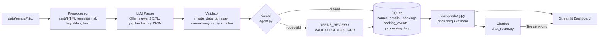

# UGR Booking AI

AI destekli e-posta rezervasyon (booking) ayrıştırma, doğrulama ve sorgulama boru hattı.

> **Temel ilke:** *LLM okur ve önerir, Python karar verir.* Model veritabanına doğrudan yazamaz; her değişiklik doğrulama kuralları ve bir "guard" katmanından geçer.

## Mimari



| Katman | Dosya | Sorumluluk |
|---|---|---|
| Ön işleme | `pipeline/preprocessor.py` | Başlık ayrıştırma, kronolojik sıra, alıntı/HTML temizliği, enjeksiyon örüntüsü, ek referansı, hash kopya |
| LLM | `pipeline/llm_parser.py` | Ollama ile yapılandırılmış çıkarım (`FakeLLMParser` testler için) |
| Doğrulama | `pipeline/validator.py`, `normalize.py`, `master_data.py` | Müşteri/liman çözümleme, tarih/sayı normalizasyonu, bloklayan ve uyarı bayrakları, durum kararı |
| Guard + araçlar | `pipeline/agent.py`, `tools/booking_ops.py` | `create/update/cancel_booking`; model önerisi guard'dan geçmeden yazılmaz, her karar `processing_log`'a düşer |
| Depolama | `models/orm.py`, `db/connection.py` | 4 tablo, her booking `source_email_id` ile kaynağına bağlı |
| Sorgu katmanı | `db/repository.py` | Dashboard ve chatbot **aynı** fonksiyonları çağırır, sayılar tutarlıdır |
| Arayüz | `ui/app.py`, `ui/chat_router.py`, `app.py` | KPI, filtreler, tablo, İnceleme Kuyruğu, grafikler, chatbot |

## Kurulum

```bash
# Sanal ortamı kur ve bağımlılıkları senkronize et (varsayılan: SQLite)
uv sync --extra dev

# (Opsiyonel) İleride PostgreSQL ile çalıştırmak isterseniz:
# uv sync --extra dev --extra postgres

# Modeli indir (Ollama sunucusu çalışıyor olmalı)
ollama pull qwen2.5:7b
```

## Yapılandırma

`.env` dosyasını `.env.example` üzerinden düzenleyebilirsiniz:

```env
DATABASE_URL=sqlite:///./ugr_booking.db
OLLAMA_HOST=http://localhost:11434
OLLAMA_MODEL=qwen2.5:7b
DATA_PATH=./data
LOG_LEVEL=INFO
```

### Veri paketi

Case veri seti gizli olduğu için repoda **yoktur** (`data/` git-ignored). `DATA_PATH` altında şu yapı beklenir:

```text
data/
├── emails/            # EMAIL-001.txt ... EMAIL-034.txt
├── manifest.json      # e-posta sırası / received_at
└── master_data/       # customers.json, ports.json, booking_schema.json
```

Sunum/test için beklenen sonuçlar `plan/expected_outcomes.json` (golden set) dosyasındadır; o da git-ignored'dır.

## Çalıştırma

```bash
# 1) E-postaları işle (gerçek Ollama)
uv run python scripts/run_pipeline.py

#    Kaydedilmiş LLM yanıtlarını yeniden kullan (Ollama gerekmez)
uv run python scripts/run_pipeline.py --reuse-llm-cache
#    İlk gerçek koşuda yanıtları cache'e yaz
uv run python scripts/run_pipeline.py --reuse-llm-cache --write-cache

# 2) Sonucu golden set ile karşılaştır
uv run python scripts/eval_real_llm.py --output docs/eval_results.md

# 3) Dashboard + chatbot
uv run streamlit run app.py
```

Chatbot, Ollama erişilemezse veya yönlendirme geçersiz dönerse regex tabanlı yedek yönlendiriciye düşer; case'in 4 örnek sorusu bu durumda da çalışır.

## Testler

```bash
uv run pytest
```

- Birim testleri: normalizasyon, ön işleme, doğrulama, guard/araçlar, repository, chat router.
- `tests/test_pipeline_e2e.py`: 34 e-postayı geçici bir DB'ye işler ve **yanlış READY olmadığını** doğrular. Gizli veri veya LLM cache yoksa atlanır.
  Golden set ile tam eşleşme kontrolleri taze bir cache ister: `E2E_STRICT_GOLDEN=1 uv run pytest tests/test_pipeline_e2e.py`.

## Varsayımlar

- Müşteri ve liman eşleştirme yalnızca master data üzerinden, tam (fold edilmiş) eşleşmeyle yapılır; bulanık eşleştirme yoktur. Gönderen alan adı müşteriyi tek başına çözmez, yalnızca ipucudur.
- Emin olunmayan değer tahmin edilmez; alan boş bırakılır ve `VALIDATION_REQUIRED` olarak işaretlenir.
- Toplam booking sayısı yalnızca `bookings` tablosunu sayar (yetim, durum sorgusu ve rezervasyon-dışı e-postalar dahil değildir).
- Chatbot sayıları şablonla üretilir; LLM sayı yazmaz. Kayıtta olmayan bilgi için sabit yanıt döner: *"Bu bilgi mevcut kayıtlarda bulunmuyor."*

## Bilinen Limitler

> 7B model, iki düzeltme e-postasını (014, 015) yeni talep sandı. Bu iki kayıt VALIDATION_REQUIRED'a düştü, READY olmadı.

- **Golden set uyumu:** 34 e-postanın 14'ü golden set ile tam eşleşiyor. Sapmaların çoğu uyarı bayraklarında (ör. `QUANTITY_FROM_VIN_COUNT`) ve model kaynaklı alan farklarında; ayrıntı için `docs/eval_results.md`. Güvenlik özelliği ölçüldü: beklenen 9 READY kayıt dışında hiçbir kayıt READY değil.
- **Yetim güncelleme/iptal:** Mevcut bir kayda bağlanamayan güncelleme/iptal e-postaları (003, 007, 023, 030) `bookings`'e girmez, İnceleme Kuyruğu'nda `ORPHAN` olarak görünür. Bunlardan yeni kayıt türetilmez.
- **Güncelleme/iptal testleri sentetiktir:** Veri setinde yalnızca 013 gerçek bir kaydı (D100) bulur; diğer akışlar sentetik create→update/cancel testleriyle doğrulanır.
- **Ekler okunmaz:** Ek referansı (ör. 029) yalnızca işaretlenir ve `MISSING_ATTACHMENT` bayrağıyla inceleme ister.
- **Küçük model:** 7B model yönlendirme ve ayıklamada hata yapabilir; bu yüzden karar mantığı modele bırakılmamıştır.
- **Canlı posta kutusu, kimlik doğrulama ve bulut dağıtımı kapsam dışıdır.**

## Üretime Geçmeden Önce

PostgreSQL + Alembic göçleri, insan onay ekranı (özellikle `NEEDS_REVIEW`), gerçek posta kutusu entegrasyonu, daha güçlü bir model ve gözlemlenebilirlik (yapılandırılmış log + metrikler).
